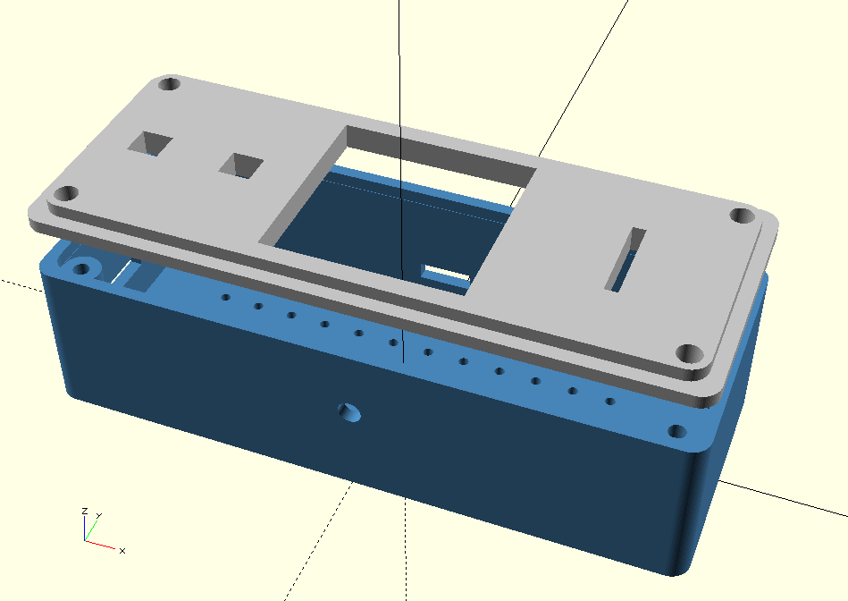

# Proyecto Gogoaty — walkie-talkie LoRa con pantalla

Un par de equipos de bolsillo (ESP8266 + módulo LoRa SX1276 + pantalla OLED, **dos botones y un potenciómetro**)
que se mandan mensajes cifrados por radio, sin móvil ni internet: texto en Morse, mensajes rápidos con icono,
letras con una rueda, frases por piezas y dibujos de 24×24 píxeles. Un hipopótamo anima la pantalla, avisa
cuando llega algo y se duerme solo. Incluye varios juegos (Tetris cooperativo, Poker, Tres en raya…) y un radar
para localizar al otro equipo. Versión del firmware: **V2.0**.

> **Estado.** Todo lo descrito aquí está verificado en el **simulador** (`sim/`, más de 40 tests con la radio y el
> chip modelados). **Falta probarlo en la placa**: ver [`path.md`](path.md) (hoja de ruta, riesgos y decisiones
> pendientes).

---

## Componentes

```
                           BILL OF MATERIALS


 REF    | COMPONENTES      | ESPECIFICACIONES           | QTY
--------|------------------|----------------------------|------------
 ES     | Microcontrolador | ESP8266 (Generic)          | 1
 LO     | LoRa Module      | SX1276 (868 MHz)           | 1
 OLD    | OLED Display     | Monochromatic I2C (4-pin)  | 1
 PR     | Push Buttons     | Generic Tactile            | 2
 PTR    | Potentiometer    | Generic Analog             | 1
 PWR    | Power Source     | 3.2V LiPo Battery          | 1
```



* Nota: El proyecto utiliza placas genéricas para el microcontrolador y la pantalla,
  usar otra placa diferente no debería suponer un problema, en caso de error,
  consulta el manual y especificaciones de la placa, probablemente se deberá a una distinta
  distribución de pines.

### Conexiones

Los pines están en [`include/Config.h`](include/Config.h). Con una placa NodeMCU (`nodemcuv2`):

| Función | GPIO | Pin NodeMCU | Notas |
|---|---|---|---|
| LoRa NSS (CS) | 15 | D8 | |
| LoRa RST | 16 | D0 | |
| LoRa DIO0 | 5 | D1 | |
| LoRa SCK / MISO / MOSI | 14 / 12 / 13 | D5 / D6 / D7 | SPI por hardware (los fija el chip) |
| Botón **A** (Morse) | 4 | D2 | a masa al pulsar (con pull-up interno) |
| Botón **B** (Finish) | 0 | D3 | a masa al pulsar; **no lo mantengas pulsado al encender** (GPIO0 = modo de carga) |
| OLED SDA | 2 | D4 | I²C, dirección `0x3C` |
| OLED SCL | 3 | RX | el SCL va al pin RX: **el equipo no puede recibir datos por el puerto serie** (por eso la hora se pone con el menú) |
| Potenciómetro | A0 | A0 | el único ADC del ESP8266 |

**Antena:** conecta siempre la antena **antes** de encender el equipo; emitir sin ella puede dañar el módulo LoRa.

### Compilar y cargar el firmware

Con [PlatformIO](https://platformio.org/) (las librerías se descargan solas, ver [`platformio.ini`](platformio.ini)):

```bash
pio run                  # compilar
pio run -t upload        # cargar en la placa conectada por USB
pio device monitor       # registro serie a 115200 baudios
```

Carga **el mismo firmware en los dos equipos** y después **empareja** uno con otro (ver *Emparejar los dos equipos*):
la clave de cifrado no viene en el firmware, la crea cada pareja. Cada equipo tiene un número propio
(**"Equipo #N"**, de 1 a 254, derivado del chip y visible en el registro serie al arrancar).

---

## Manual de usuario

### Controles

El equipo se maneja con dos botones y el potenciómetro:

| Control | Para qué sirve |
|---|---|
| **Potenciómetro** | Mueve el cursor / elige una opción / cambia un valor |
| **Botón A** | Aceptar, entrar, "poner", avanzar |
| **Botón B** | Volver, salir, borrar |
| Pulsación **larga** | Acciones especiales (enviar, cancelar…): se indican en cada pantalla |

### Pantalla principal

Tres iconos en fila (gira el potenciómetro para mover el cursor y pulsa **A** para entrar) y el hipopótamo debajo:

* **Env** — enviar un mensaje. **Hist** — historial de mensajes. **Jueg** — juegos.
* **Barra superior:** a la izquierda, tu batería; en el centro, la **hora** (`--:--` si nadie la ha puesto);
  a la derecha, el **corazón** (vacío = nadie en alcance; lleno = al menos un compañero cerca) y, junto a él, la
  **batería del compañero** (la más baja de los que están en alcance; un `!` indica que alguno tiene la batería baja).
* **Insignia en "Hist"**: número de mensajes **sin leer** (`9+` si hay más de 9).
* Cuando llega un mensaje, el hipopótamo **persigue al corazón**.
* **Mantén B 1,5 s** en esta pantalla para abrir **Ajustes**: *Poner la hora* y *Emparejar* (ver más abajo).

### Emparejar los dos equipos

Cada pareja de equipos tiene su **propia clave secreta**, que se crea al emparejarlos (no viene en el firmware). **Mientras
un equipo no tenga pareja no envía ni acepta nada**: *Env* y los juegos por radio muestran "Sin pareja". Se hace **una sola vez**:

1. En **los dos equipos**: pantalla principal → **mantén B** 1,5 s → **Ajustes** → **Emparejar** (potenciómetro para elegir, **A** para abrir).
2. Con *"Buscando…"* en las dos pantallas, los equipos se encuentran solos en unos segundos y calculan la clave. En cada pantalla
   aparece un **código de 6 dígitos**.
3. **Compara los dos códigos.** Si son **iguales**, pulsa **A** en los dos (el primero verá "Esperando al otro…"). Si son
   **distintos**, o tienes dudas, pulsa **B**: no se guarda nada.
4. *"¡Emparejado! Solo vosotros dos podéis hablar."* La clave queda guardada en el equipo y **sobrevive a reinicios**.

Para cambiar de pareja se repite el proceso (el equipo avisa de que la clave anterior se sustituye). Si no se encuentran en 3 minutos, se cancela sin cambiar nada.

**Qué te da, de verdad:**

* Nadie sin la clave puede **leer** los mensajes, **inventar** uno que el equipo acepte, **modificarlo** al vuelo, ni **repetir** uno
  antiguo que hayas capturado (cada paquete lleva un contador que solo avanza y una firma de 8 bytes).
* Un tercero cercano no puede colarse en el emparejamiento sin que lo notes **si comparas el código de verdad**: para
  engañar a los dos equipos tendría que acertar un código de 6 dígitos (1 entre un millón por intento).
* Un equipo que no es tu pareja no puede leer tus mensajes (ni tú los suyos): lo que oye es ruido cifrado.

**Qué NO te da** (no existe el "100 %"):

* El **código solo protege si lo comparas**. Si pulsas A sin mirar el otro equipo, el emparejamiento queda sin proteger.
* La clave está en la memoria del equipo **sin cifrar**: quien tenga el equipo en la mano y sepa leer su memoria la obtiene.
* Se puede **ver que hay radio**: el número de equipo, cuándo emite y el tamaño de los paquetes no se ocultan (el contenido sí).
* No hay defensa contra un **inhibidor** (alguien que sature la banda): impide la comunicación, no la espía.
* Tras **reiniciar el equipo que recibe**, un atacante que hubiera capturado paquetes recientes (hasta 4096 de los últimos) podría repetir uno una vez.
* **Solo hay una pareja**: la clave es de dos equipos; un tercero no puede unirse a la conversación.

### Enviar un mensaje

**Env → eliges el modo con el potenciómetro y pulsas A.** Hay cinco modos (B vuelve):

| Modo | Cómo se usa |
|---|---|
| **Morse** | **A corta** = punto, **A larga** (≥ 0,25 s) = raya. **B corta** cierra la letra. **B larga** (1,5 s) **envía**. **A muy larga** (2 s) cancela. Cinco puntos (`.....`) = espacio. La pantalla enseña la tabla Morse. Sin tocar nada 45 s, cancela. |
| **Instant** | Ocho mensajes con icono: *cansada, hambrienta, meh, kissy, happy, busy busy, Zi, Nour*. Gira el potenciómetro y pulsa **A** para enviar. |
| **Rueda** | Escribe texto libre: el potenciómetro elige la letra (espacio y A–Z), **A** la añade, **B corta** borra la última, **B larga** **envía**, **A larga** cancela. |
| **Frase** | Compón una frase por piezas **Sujeto + Verbo + Objeto**: el potenciómetro elige la opción de cada categoría, **A** la fija y pasa a la siguiente (en la última, envía), **B corta** retrocede, **B larga** envía ya. **A larga** gestiona tus **piezas propias** (se escriben con la Rueda y se guardan en el equipo). |
| **Dibujar** | Lienzo de 24×24: el potenciómetro mueve el cursor **arriba/abajo**; **mantén A** (0,3 s) y gira para moverlo a **izquierda/derecha**; **A corta** pinta un punto, **B corta** lo borra; **mantén B** (1,5 s) para **enviar**. Sin tocar nada 25 s, descarta el dibujo. |

El texto de un mensaje admite hasta **92 caracteres** (sin tildes ni eñes: la fuente de la pantalla no las tiene).

Al enviar sale una pantalla con el resultado:

* **Enviado — esperando confirmación…** → al llegar al otro equipo pasa a **¡Entregado!** (con un tic) y "visto por el otro".
* Si en unos 3 s no llega la confirmación: **(sin confirmar)**. No pasa nada: el equipo **reintenta solo** (hasta 3 veces,
  cada ~5 s) y, si el compañero estaba fuera de alcance, lo reenvía en cuanto vuelva a oírlo. Los mensajes pendientes
  **sobreviven a un reinicio**.
* **A** vuelve a empezar (otro mensaje), **B** vuelve al menú principal.

Si varios equipos reciben el mismo mensaje, todos lo confirman; basta la primera confirmación para marcarlo como entregado.

### Historial

**Hist** muestra los **10 últimos mensajes** (recibidos y enviados; al llegar el undécimo se descarta el más
antiguo). Se guardan en el equipo y **sobreviven a un reinicio**.

* Cada fila indica la antigüedad (`3m`, `--` si no se conoce), el texto y, si es tuyo, `Tu:`. Un **punto** marca los **no leídos**.
* El potenciómetro recorre la lista; **A** abre el mensaje completo ("De #N" o "Enviado" y cuánto hace); **B** sale.
* Dentro de un mensaje: **A** = borrar (te pide confirmar: **A** sí, **B** no), **B** = volver.
* Los **dibujos** salen como `[dibujo]` y al abrirlos se ven completos, también los que enviaste tú.
* Un mensaje pasa a *leído* al abrirlo o al salir de la lista si su fila llegó a verse.

### Avisos y suspensión

* A los **5 minutos sin tocar nada** el equipo se **suspende**: apaga la pantalla (y la CPU descansa), pero la **radio sigue escuchando**.
* Si llega un mensaje o un dibujo con la pantalla apagada, **se enciende 8 s** con una vista previa (*Mensaje nuevo — De #N*):
  **A** lo abre en el Historial, **B** la cierra; si no pulsas, se apaga sola.
* Para **despertar**, pulsa un botón **3 veces** (en menos de 45 s).

### Poner la hora

El equipo no tiene reloj propio: la hora se pone **una vez** y se **comparte por radio**.

1. En la pantalla principal, **mantén B** 1,5 s → **Ajustes** → **Poner la hora**.
2. Con el **potenciómetro** eliges las **horas**; **A** pasa a las **decenas de minuto**, otra vez **A** a las **unidades**, y **A** guarda. **B** vuelve atrás (en las horas, cancela).
3. El otro equipo **adopta la hora** en cuanto oye la baliza (la última hora puesta gana, aunque sea anterior). La hora se guarda y es la **hora local**: al cambiar de horario de verano/invierno hay que ponerla de nuevo.

La hora se usa para la antigüedad de los mensajes ("hace 3m").

### Juegos

**Jueg** → elige con el potenciómetro (A entra, B sale):

| Juego | Cómo se juega |
|---|---|
| **Tetris Coop** | Tablero **cooperativo** compartido. Modos: *Jugar con CPU*, *2 Jug: Crear* (anfitrión) y *2 Jug: Unirse* (invitado, con otro equipo por radio). **Potenciómetro** = columna de la pieza, **A** = girar, **B corta** = caída rápida, **mantén B** = salir (en *Buscando partida…* B cancela). Cada uno ve **su** pieza maciza (leyenda *Tu*) y la del otro hueca. |
| **Poker** | Texas Hold'em contra la CPU (1000 fichas, ciegas 10/20). **B** cambia de acción (igualar/pasar, subir, retirarse) y **A** confirma. |
| **RefillGame** | "La Cervecería": llegan jarras; el **potenciómetro** regula el caudal del grifo y **A** para y entrega la jarra. Gana puntos cuanto más cerca de la marca; desbordar o quedarse corto cuesta una vida (3). |
| **Choose4Me** | Una bola mágica: piensa una pregunta, **A** para preguntar; **B** sale. |
| **HippoRadar** | Localiza al otro equipo: **ambos** abren el radar (A para empezar). Pasa de *BUSCANDO* a *GIRA DESPACIO* (frío / tibio / caliente) y, al bloquearse, a *VE HACIA AQUÍ* con una flecha y la distancia estimada. **A** reinicia la búsqueda, **B** sale. El radar usa otra configuración de radio de más alcance, en la que no se oye el chat; por eso **cada 4 s vuelve 1,2 s a la del chat** (ventana de chat): ahí se reciben y confirman mensajes, salen las balizas y los reintentos, y no se emiten pings. Un mensaje que llegue fuera de la ventana no se oye (el emisor reintenta). Al salir se anuncia. |
| **3 en raya** | Para dos equipos. Emparejamiento automático ("Buscando rival…"): el equipo con el número **menor** juega con la **X** y mueve primero. **Potenciómetro** elige la casilla, **A** coloca la ficha; **mantén B** para salir. |

**Los mensajes siguen llegando mientras juegas** (Tetris, Tres en raya, HippoRadar…): se guardan en el Historial y se confirman,
y los verás como no leídos al salir al menú. (En el radar de HippoRadar, solo en sus ventanas de chat: ver arriba.)

### La radio

* Banda de **868 MHz**, modulación LoRa **SF7**, 125 kHz; los mensajes van **cifrados (AES-128) y firmados (AES-CMAC)** con la clave de la pareja (ver *Emparejar los dos equipos*).
* **Alcance:** depende de la antena y del entorno (todavía no medido en la placa). El radar usa un modo
  de más alcance (SF10, +20 dBm).
* **Presencia:** cada equipo emite una **baliza** cada ~30 s; si un compañero lleva más de 90 s sin oírse se considera fuera de alcance
  (el corazón se vacía).
* **Varios equipos:** el sistema recuerda hasta **4 compañeros** a la vez; los mensajes se difunden a todos.
* **Uso responsable:** en la banda de 868 MHz de la Unión Europea hay límites de potencia y de tiempo de emisión; ver el apartado
  *Límite legal* de [`path.md`](path.md).

### Solución de problemas

| Síntoma | Qué mirar |
|---|---|
| "Sin pareja" al enviar o al abrir un juego | Los dos equipos deben **emparejarse** una vez: mantén **B** 1,5 s en la pantalla principal → *Emparejar* (en los dos). |
| El emparejamiento no avanza de "Buscando…" | Los dos equipos tienen que estar en *Emparejar* a la vez, con antena y al alcance de la radio. |
| Tras emparejar, no se oyen aunque estén cerca | Si uno se emparejó con **otro** equipo después, la clave ya no coincide: vuelve a emparejar los dos entre sí. |
| La pantalla no enciende / está en negro | ¿Está **suspendido**? Pulsa un botón 3 veces. Comprueba SDA/SCL y la dirección `0x3C`. |
| No se oyen los equipos | **Emparejados entre sí**, mismo firmware en los dos, **antena conectada**, a menos distancia; que ninguno esté en el **radar** de HippoRadar (solo oye el chat 1,2 s cada 4 s). El registro serie muestra `[LoRa] ...` y `[Presencia]`. |
| Dos equipos que no se ven aunque están cerca | Pueden tener el **mismo número** (el identificador es de 1 byte derivado del chip: raro, ~0,4 %); en ese caso un equipo ignora los mensajes del otro. Compara "Equipo #N" en el registro serie al arrancar. |
| `--:--` en lugar de la hora | Nadie ha puesto la hora aún: mantén **B** 1,5 s en la pantalla principal. |
| El nivel de batería siempre marca 100 % | Es lo esperado hoy: el único ADC del ESP8266 lo usa el potenciómetro y medir la batería requiere hardware dedicado (ver `path.md`). |
| El equipo no arranca con la placa conectada | No mantengas pulsado **B** (GPIO0) al encender. |

---

## Simulador y pruebas

El directorio [`sim/`](sim/) contiene un **simulador nativo de PC** que compila y
ejecuta el firmware real (`src/`) sin necesidad de hardware: renderiza la pantalla
OLED 128×128, simula botones, potenciómetro y la radio (el **chip SX1276 a nivel de registros**, con tiempos en el aire,
half-duplex y colisiones; cifrado AES real), y permite tanto un **modo interactivo por teclado** como **tests automatizados**
(también con **varios equipos a la vez**, con el mismo tiempo virtual y resultados deterministas).

```bat
cd sim
run_tests.bat            :: compila y ejecuta toda la batería de tests
run.bat                  :: modo interactivo (teclado)
```

Requiere *Visual Studio Build Tools* (C++). Más detalles en [`sim/README.md`](sim/README.md).

En **Linux (GNOME)** hay una versión equivalente y separada en [`sim/linux/`](sim/linux/):

```bash
cd sim/linux
./run_tests.sh           # compila y ejecuta toda la batería de tests (48 suites)
./seed_tests.sh 1 50     # la misma batería con 50 secuencias aleatorias (descubre tests que dependen de la suerte)
./net_test.sh            # pruebas con varios equipos a la vez sobre el "aire" compartido (11 escenas, incluidas partidas
                         # de 3 en raya, Tetris y HippoRadar entre dos firmwares reales y el emparejamiento)
./run.sh                 # modo interactivo (abre una ventana de GNOME Terminal)
```

Requiere `g++`/`gcc`. Más detalles en [`sim/linux/README.md`](sim/linux/README.md).

La hoja de ruta (qué está terminado, qué falta, riesgos y decisiones pendientes) está en [`path.md`](path.md).
